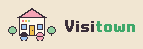
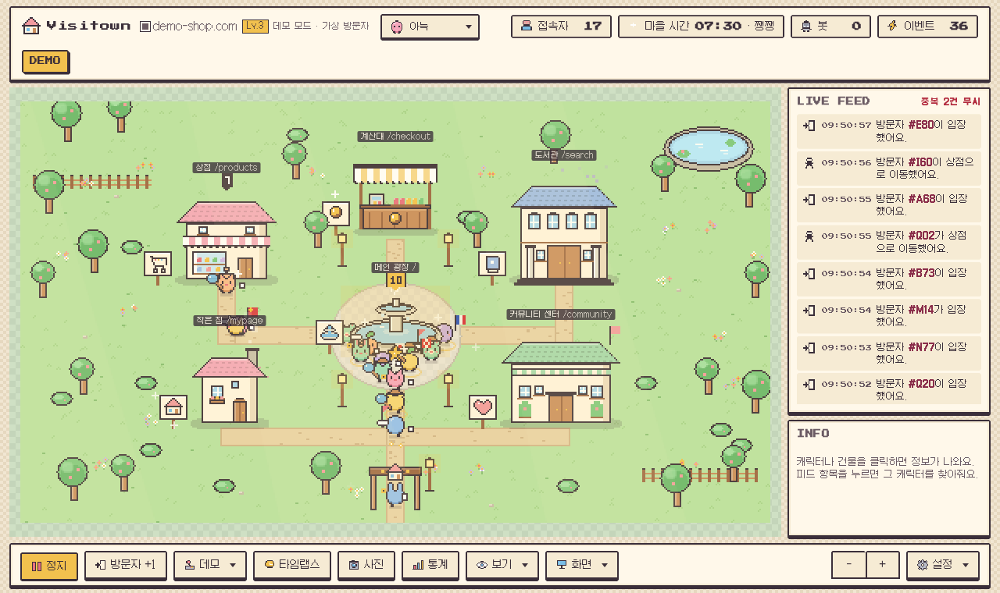
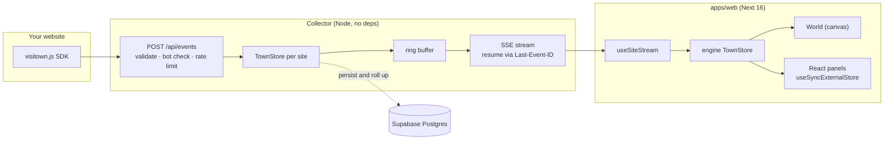

<h1></h1>

**Your website's visitors, walking around a pixel town in real time.**
Every visitor becomes a little character, every page becomes a building, and you watch people move between them as they browse.

**[Live landing](https://visitown.vercel.app)** · **[Demo (no server needed)](https://visitown.vercel.app/demo)** · [Design system](https://visitown.vercel.app/design-system)



## What's inside

- **Zero-dependency collector** (`server/`, plain Node): ingest → per-site in-memory `TownStore` → SSE fan-out. One process holds **1,000 SSE subscribers at 500 events/s for 10 minutes with p99 39 ms and 0 lost frames** ([docs/load.md](docs/load.md)).
- **Lossless reconnect**: a per-site ring buffer plus `Last-Event-ID` replays only what the client missed. If the gap is too old, the server sends a fresh snapshot instead.
- **DOM-free rendering engine** (`packages/engine`, TypeScript): store, simulator, map and canvas world. It loads in Node for tests, and the canvas is injected through the constructor.
- **React panels over an external store** (`packages/ui`): `useSyncExternalStore` with 250 ms batching for fast-changing counters. Selection has a single source of truth (`store.selectedId`). The SSE lifecycle lives in a `useSiteStream` hook (tickets, backoff, `lastEventId`, StrictMode-safe cleanup).
- **Next 16 App Router** (`apps/web`): per-request nonce CSP with `'strict-dynamic'` and no `'unsafe-inline'`. Server-rendered public towns with OG metadata. Old embed URLs are kept alive with rewrites.
- **Tracking SDK** (`sdk/visitown.js`): about 7 KiB gzipped (enforced by a test), batched sends, an offline queue with backoff, SPA route tracking and TypeScript types.
- **Accessibility**: 0 axe violations on every route (checked in CI), keyboard navigation of the canvas, and a 30-second screen-reader summary instead of a noisy live feed.
- **Also**: horizontal scaling across instances via Supabase Realtime broadcast with a DB leader lease, a read-only MCP server (`server/mcp.js`), and 99 tests (`node:test`, fast-check property tests, Playwright smoke tests) in GitHub Actions.

## Architecture



## Quick start

```bash
npm ci && npm run build
npm start                                  # http://localhost:3000/demo (simulated visitors)
DEV_TOKEN=dev node server/index.js         # collector on :8787, no database needed
```

With the collector running, open `http://localhost:3000/app?api=http://localhost:8787&site=site_demo&token=dev` to see live data. Add the SDK to any page served from `localhost:3000`:

```html
<script src="http://localhost:8787/visitown.js" data-site="site_demo" async></script>
```

Tests: `npm test` (unit, API and Playwright smoke tests; run `npm run build` first).

**About the IDs in the code:** the site ID and embed key in `apps/web/app/LandingClient.tsx` are public, read-only values. An embed key can only stream one town and cannot call any other API.

License: MIT. The rest of this README is in Korean.

---

## 한국어

웹사이트 방문자를 픽셀 캐릭터로, 페이지를 마을 건물로 보여주는 실시간 방문자 시각화 서비스. SDK가 보낸 이벤트를 수집 서버가 받아 SSE로 대시보드에 흘려보내고, 서버 없이 가상 방문자로 도는 데모(`/demo`)도 있다. 기능 명세는 `docs/spec.md`.
실제 데이터 없이 가상 방문자 시뮬레이터로 동작한다. 기능 명세는 `docs/spec.md`.

## 실행

웹 앱은 `apps/web`(Next 16, App Router, TypeScript). 배포본은 https://visitown.vercel.app (Vercel 프로젝트의 Root Directory를 `apps/web`으로 두고 GitHub `main` 푸시마다 자동 배포). `/`가 랜딩, `/app`이 대시보드(파라미터 없이 열면 진입 화면: GitHub 로그인 또는 데모), `/demo`가 서버 없는 시뮬레이터, `/app?api=…`면 그 서버로 실시간 연결한다. 진입 화면의 기본 서버는 `apps/web/lib/api.ts`의 `DEFAULT_API`(환경변수 `NEXT_PUBLIC_VT_API`, 로컬에서 열면 localhost:8787). 외부 의존성은 서체 둘뿐이다. 한글·본문은 Galmuri11(jsDelivr CDN, OFL), 숫자·제목은 Press Start 2P(Google Fonts). 둘 다 없어도 시스템 서체로 동작한다.

```bash
npm ci && npm run build   # packages/engine·ui 번들(테스트용) → apps/web next build
npm start                 # http://localhost:3000 (next start). 개발은 ./dev.sh(next dev 5173 + 수집 서버 8787)
```

```bash
npm test             # 테스트 99건: 스토어 불변식(tests/store.test.js)·fast-check 속성(invariants)·해금(unlocks)·SDK 크기·타입(sdk)·서버 API 계약(api)·속도 제한·헤더(limits)·SSE 재접속(sse)·수평 확장(peers)·MCP(mcp)·Playwright 데모·SDK·XSS·CSP·재접속 스모크(smoke)
npm run test:unit    # 서버 없이 도는 것만 (store·invariants·unlocks·sdk·engine·ui)
```

테스트는 `node:test`로 쓰고 서버 런타임 의존성은 그대로 0이다(루트 `package.json`의 devDependencies는 fast-check·playwright·typescript·esbuild, 브라우저 번들에 들어가는 next·react·react-dom은 `apps/web`·`packages/ui`). `api.test.js`는 `server/index.js`를 빈 포트에 DB 없이 띄워 수집 → 상태 → SSE를 확인하고, `smoke.test.js`는 빌드된 웹 앱을 `next start`로 띄워 `/demo`·`/app`·`/embed/[key]`·`/town/[slug]`·`/`·`/design-system`을 헤드리스 Chromium으로 열고 콘솔 error·pageerror·4xx·CSP 위반이 0건인지 본다(`npm run build` 먼저). GitHub Actions(`.github/workflows/ci.yml`)가 `main` 푸시·PR마다 빌드 → 단위 → API → 스모크 순으로 같은 것을 돌린다.

## 구조

| 파일 | 내용 |
| --- | --- |
| `apps/web/` | Next 16(App Router, TS) 웹 앱. 라우트는 `app/`: `/`(랜딩 `page.tsx`+`LandingClient.tsx`), `/app`·`/demo`(대시보드, `components/DashboardShell.tsx`), `/embed/[key]`(임베드, `components/EmbedTown.tsx`), `/town/[slug]`(공개 마을, 서버 렌더링 + `generateMetadata` OG), `/design-system`. `proxy.ts`가 요청마다 nonce CSP·X-Frame-Options, `next.config.ts`가 보안 헤더·옛 주소 redirect/rewrite |
| `apps/web/shell/dashboard.html`·`dlg.html` | 대시보드 마크업(예전 `src/p1.html`의 body)과 픽셀 확인창. 서버 컴포넌트가 그대로 넣는다(`dangerouslySetInnerHTML`) |
| `apps/web/shell/dashboard.css`·`shell.css` | 대시보드 레이아웃·패널·모달 CSS와, 그 뒤에 오는 디자인 시스템 공통 CSS(색 토큰·모션·버튼·체크박스·태그·드롭다운·확인창·픽셀 노치). 랜딩·디자인 시스템 페이지도 `shell.css`를 쓴다 |
| `apps/web/shell/dashboard.js` | 대시보드 셸(예전 `src/p6.js`): 컨트롤, 테마 전환, 타임랩스 리플레이, 녹화·TV 모드, 통계·도감·설정 패널(DOM), 메인 루프. 클라이언트가 마운트 뒤 `boot({ demo })`로 한 번 시작하고 `@visitown/ui`를 피드·정보·헤더에 마운트한다. 테스트·콘솔 손잡이는 `window.__vt` |
| `apps/web/shell/helpers.js`·`sfx.js` | 디자인 시스템 헬퍼(`esc`·`pxSelect`·`showEl/hideEl/pop/say`·`errText`·`ask/note`)와 효과음·배경음 합성(`SOUNDS`·`synth`·`bgm`). 대시보드와 디자인 시스템 페이지가 같이 import한다 |
| `apps/web/shell/embed.ts`·`embed.css` | 임베드 마을: 엔진 + 공개 임베드 키 스트림만(대시보드 셸·React 패널 없음). `/embed/[key]`와 `/town/[slug]`가 쓴다 |
| `apps/web/shell/ds.html`·`ds.js`·`ds.css` | 디자인 시스템 페이지(`/design-system`) |
| `apps/web/public/` | 정적 파일: `icons/`(파비콘·PWA 아이콘), `legal/`(약관·개인정보처리방침), `manifest.webmanifest`, `sw.js` |
| `packages/engine/src/palette.ts` | 팔레트 `BASE_PAL`, 아이콘·숫자·글자 픽셀 정의, 캐릭터 도트, **테마 정의 `THEMES`** (아늑·RPG·오피스) |
| `packages/engine/src/map.ts` | 맵(건물 위치, 웨이포인트 그래프, 서는 자리), 픽셀 헬퍼, 건물·나무·소품 생성 함수, `buildAssets(theme)`. 캔버스 공장(`setCanvasFactory`)·겉 화면 정보(`setShellInfo`)는 UI가 넣는다 |
| `packages/engine/src/themes/*.ts` | 테마 하나당 파일 하나(`THEMES.<키>` + 건물 그림 함수 + 자기 장식). `index.ts`가 import만 해도 등록된다 |
| `packages/engine/src/store.ts` | `TownStore`(세션 맵·건물별 인원·중복 제거·하트비트 만료·`selectedId`), `Simulator`(가상 방문자·봇·내 캐릭터). 타입은 `types.ts` |
| `packages/engine/src/world.ts` | `World`(캐릭터 이동·이펙트·파티클·낮밤 렌더링). 저장소 변화만 구독하고 캔버스는 생성자로 받는다 |
| `packages/engine/dist/` | `npm run build:packages`가 만든 테스트용 CJS 번들(`index.cjs`)과 타입 선언(`types/`, UI 패키지·웹 앱의 tsc가 본다). git에 없다. 웹 앱은 `src/*.ts`를 Next가 직접 묶는다(`exports.import`) |
| `packages/ui/src/*.tsx` | React 패널(로드맵 53): `Feed`(피드 줄, 조각 배열 렌더), `InfoPanel`(`store.selectedId`로 캐릭터·건물·떠남), `HeaderStats`(접속자·봇·이벤트·시계·날씨). `mount()`가 엔진 인스턴스를 받아 `#feed`·`#infoBody`·`#statsBox`에 붙이고 `useSyncExternalStore`로 구독만 한다. 엔진은 타입으로만 본다 |
| `packages/ui/dist/` | `index.cjs`(테스트용, react 외부). git에 없다. 웹 앱은 `src/*.tsx`를 직접 묶는다 |

## 핵심 설계

- 내부 해상도 480×270, `imageSmoothingEnabled=false`. 배율은 맞춤 배율 × 사용자 확대(`apps/web/shell/dashboard.js`의 `setScale`): 휠·+/- 버튼은 목표 배율로 프레임마다 보간(`zoomTo`/`tickZoom`)하고 핀치는 바로 적용. 휠·핀치는 포인터 아래 지점이 제자리에 있도록 스크롤을 보정하며 연속 배율, +/- 버튼은 정수 배율. 스크롤 컨테이너는 `#viewport`(스크롤바 숨김, 마우스 드래그로 이동, 4px 이상 움직이면 클릭이 아닌 드래그)이고 패널·리플레이 바·미니맵 같은 오버레이는 `#stage`에 고정이다. 맞춤 배율보다 확대되면 오른쪽 아래 미니맵(`#mini`, 96×54)이 나타나고 누르거나 끌면 그 지점이 화면 가운데로 온다. 폰(≤700px)은 상·하단 바를 한 줄로 눌러 지도에 자리를 준다.
- 이벤트 형식은 명세의 SDK 형식 그대로: `{ event_id, site_id, session_id, event_type, page_path, timestamp, properties }`.
- 저장소와 렌더러 분리. 실제 연동 시 시뮬레이터 대신 `store.apply(event)`만 호출하면 된다 (`dashboard.js` 끝의 `connectRealtime` 주석 참고).
- 같은 `event_id`는 무시, 늦게 온 이벤트로 페이지 역행 없음, 건물별 인원 합계 == 접속자 수(2초마다 자가 검사).
- 봇은 `properties.bot`으로 구분해 접속자 수에서 제외하고 따로 센다.
- 커스텀 이벤트 이름은 자유(`visitown.track('add_to_cart', { amount, sku })`, 영문 소문자·밑줄 2~32자). 시스템 4종(`session_start`·`page_view`·`heartbeat`·`page_leave`) 말고는 사이트마다 서로 다른 이름 50가지까지 받고(설정에 적은 이름은 항상 허용), 넘친 이름은 버리고 이벤트 설정 화면에 보여 준다. 커스텀 이벤트에는 정해진 속성 말고도 임의 속성 10개(키 `^[a-z_][a-z0-9_]{0,31}$`, 문자열 100자·숫자·불리언)가 붙는다. `amount`는 매출 집계에 쓰는 특별 키.
- 방문자 속성은 `session_start`의 `properties`로 받는다: `device`, `returning`, `referrer`, `plan`, `bot`, `country`(두 글자 나라 코드, 서버가 정한다). 캐릭터 표식은 기본값이 아닌 것만 붙는다(재방문 모자, 모바일·태블릿, 검색·SNS·광고 유입, 유료 링, 주 국가가 아닌 나라의 깃발 `FLAG_ROWS`). 주 국가는 `TownStore.homeCountry`(사람 접속자 과반·2명 이상). 보기 메뉴 "방문자 표시" 토글(임베드 `marks=0`)로 표식을 모두 끌 수 있다. 정보 패널에는 모든 속성이 태그로 나오고 나라는 이모지 깃발 + 한국어 이름이다. 캐릭터를 누르면 기본으로 따라가기가 켜지고, 같은 캐릭터를 다시 누르거나 버튼을 끄면 멈춘다.

## 테마·스프라이트 교체

기본 셋(아늑·RPG·오피스)은 `packages/engine/src/palette.ts`의 `THEMES`에 있고, 새 테마는 `packages/engine/src/themes/<키>.ts` 파일 하나로 추가하고 `index.ts`에 import 한 줄을 더한다. 파일은 즉시 실행 함수로 감싸고 `THEMES.<키>`(이름, `order`, 팔레트 덮어쓰기, 캐릭터 6형태×6색, 건물 12종의 이름·그림 함수·표지판 아이콘, 장식 종류)를 넣은 뒤 `Object.assign(BUILD, { <키>_plaza(){…}, … })`로 건물 그림 함수를 등록한다. 자기 나무·문·연못은 `DECOR_KIND.tree/gate/pond.<이름>`에 등록하면 `makeTree`/`makeGate`/`makePond`가 그걸 쓴다. 팔레트는 UI 아이콘 색에도 쓰이니 outline·white는 대비를 유지한다.

테마 고르기는 상단 드롭다운(`#themeSel`, 항목 그림은 그 테마의 첫 캐릭터)과 숫자 1~9, T(다음 테마)다. 고른 테마는 그 브라우저에만 기억한다(`vt_theme`). 임베드는 `theme=` 파라미터.

겉 화면(바·패널·모달) 밝기는 보기 메뉴 "밝기"(자동·밝게·어둡게)와 D 키로 바꾸고 `vt_shell`에 기억한다. 자동이면 OS 설정을 따른다. 색은 `apps/web/shell/shell.css`의 `:root` 토큰과 `:root[data-shell=dark]` 덮어쓰기 한 벌이고, 테두리·픽셀 그림자는 `--edge`, 글자는 `--ink`로 나눠 쓴다. 마을 캔버스 색은 테마 팔레트라 밝기와 상관없다.
실제 에셋 팩으로 바꿀 때는 `map.ts`의 `BUILD.*`, `makeTree`, `makeGate`, `makeSign`이 이미지로 그린 캔버스를 돌려주게 바꾸면 되고, 캐릭터는 `charFrame()`이 돌려주는 `{canvas, ax, ay}`(발 밑 기준점)만 맞추면 렌더러는 손대지 않는다.

## Phase 2: 실제 연동 (로컬에서 돌리기)

세 개를 띄우면 테스트 사이트의 탭이 대시보드의 캐릭터로 보인다. `./dev.sh`는 서버·대시보드를 띄우고, 인자로 사이트를 주면 셋을 한 번에 띄운다(`./dev.sh demo`는 demo-site, `./dev.sh <폴더>`는 그 폴더에서 `npm run dev`, Ctrl+C 또는 `q`로 전부 종료). 포트를 이미 쓰는 프로세스가 있으면 끄고 새로 띄울지 묻고, `./dev.sh -r`은 묻지 않고 끈다(완전 재시작). 도중에 하나가 죽어도 스크립트는 끝나지 않으며 `r`(죽은 것 다시), `s`/`d`/`t`(서버·대시보드·사이트 하나만 다시), `b`(엔진·UI 패키지 번들 다시) 키로 되살린다. 따로 띄우려면:

```bash
# 1. 수집·실시간 서버 (의존성 없음)
node server/index.js                      # http://localhost:8787, 토큰 dev

# 2. 테스트 사이트 (Next.js)
cd demo-site && npm install && npm run dev   # http://localhost:3000

# 3. 웹 앱 (Next dev, apps/web)
npm run dev -- -p 5173                    # http://localhost:5173 (next dev)
# 브라우저: http://localhost:5173/app?api=http://localhost:8787&site=site_demo&token=dev
```

`/demo`로 열면 시뮬레이터 모드다. 연결 정보는 한 번 넣으면 localStorage에 남고, 하단 "연결 설정"에서 바꿀 수 있다.

| 경로 | 내용 |
| --- | --- |
| `server/geo.js` | 방문자 나라 판정. 프록시 나라 헤더 → `GEOIP_URL`(선택, `{ip}` 치환, 24시간 캐시) → SDK가 보낸 시간대 → 언어 지역. IP·시간대·언어는 저장하지 않고 `country`만 남긴다 |
| `server/index.js` | HTTP 서버. `POST /api/events`, `GET /visitown.js`, `GET /api/sites/:id/state|stream|pages|events|eventtypes|embed|daily|unlocks|badge|notes|webhook|widget|trails|public`, `POST /api/sites/:id/stream-ticket`(SSE용 30초 일회용 티켓, `docs/security.md` S-29), `GET /api/public/sites`(공개 마을 목록), `DELETE /api/account`(계정 삭제), `/healthz`. SSE: `snapshot`(pages·eventTypes·unlocks·weather·vitals 포함)·`event`·`pages`·`eventtypes`·`unlocks`·`trails`·`alert`·`weather`·`vitals`·`milestone` |
| `server/alerts.js` | 웹훅(슬랙·디스코드)·SSE 알림: 알림 켠 이벤트, 접속자 기준, 조용함, 이상 감지, 아침 요약 |
| `server/badge.js` | README용 "지금 N명 보는 중" SVG 배지 |
| `server/unlocks.js` | 테마 해금 판정. 사람 방문(봇·`vt_me` 제외)으로 진행도를 올리고 `sites.unlocks`에 저장. 같은 상태에 누적 방문 `visits`, 희귀 방문자 수집(`rare`), 기록 갱신(`records`)도 둔다(`judge`·`observeOnline`·`takeMilestones`) |
| `server/maintenance.js` | 일별 집계(`page_daily`) + 원본 정리. 켜지고 2분 뒤·매시간 `vt_rollup`/`vt_prune` rpc. 보관은 `EVENT_RETENTION_DAYS`(기본 7일), 하루 경계 `ROLLUP_TZ`(기본 Asia/Seoul) |
| `server/rollup.js` | 같은 작업을 한 번 수동으로: `node server/rollup.js 30`(30일치 집계 + 정리), `--no-prune` |
| `server/store.js` | 사이트별 세션 상태. 검증·중복 제거·역행 방지·45초 만료·스냅샷. 날씨(`weather()`)·건물별 웹 바이탈 p75(`vital()`·`vitalsView()`)·인사 이모지 목록(`GREET_EMOJI`) |
| `server/bots.js` | User-Agent 봇 목록 |
| `server/auth.js` | 대시보드 인증. `JWT_SECRET`이 있으면 Supabase JWT, 없으면 `DEV_TOKEN` |
| `server/persist.js` | page_view·커스텀 이벤트를 5초 배치로 Supabase에 기록. `SUPABASE_URL` 없으면 무동작 |
| `server/sites.json` | 로컬 사이트 설정(허용 Origin, 경로→건물 패턴). 운영에서는 Supabase `sites` 테이블 |
| `sdk/visitown.js` | 추적 스크립트. `<script src="…/visitown.js" data-site="site_xxx" async>` 한 줄. 옵션 `data-widget`(미니 위젯, 인사 이모지 포함)·`data-errors`(오류 수집)·`data-vitals`(LCP·INP·CLS)·`data-consent`. 1초 묶음 전송, 실패분은 `localStorage.vt_q`에 두고 백오프 재시도·다음 로드가 이어 보냄(로드맵 45, 동작 설명은 `sdk/README.md`) |
| `sdk/visitown.d.ts`·`index.mjs`·`package.json` | npm 패키지 `@visitown/sdk`(번들러용). `import { init, track } from '@visitown/sdk'; init({ site, api, widget, errors, vitals, consent })`. 같은 `visitown.js` 한 파일을 쓰고, gzip 7KiB 예산을 `tests/sdk.test.js`가 CI에서 지킨다 |
| `server/mcp.js` | 읽기 전용 MCP 서버(stdio, 의존성 없음). 도구 `online`·`today`·`top_pages`·`records`·`funnel`. 루트 `.mcp.json`이 로컬 서버 기본값 |
| `server/sse.js` | SSE 링버퍼(`Ring`)·프레임. 재접속하면 `Last-Event-ID` 뒤만 다시 보낸다(로드맵 44) |
| `server/peers.js` | 수평 확장(로드맵 46): 인스턴스끼리 이벤트·설정을 Supabase Realtime broadcast로 주고받는다. 리더는 `vt_lease` |
| `tests/perf/render.js` | 렌더 기준 측정(로드맵 47): `next start`의 `/demo` 10초의 fps·프레임 시간·긴 작업 수·메인 스레드 점유 |
| `tests/load/run.js` | 부하 테스트(의존성 없음). 구독자 S·초당 E건·D초로 지연 p50/p95/p99·유실·RSS·CPU·재접속 복구를 잰다. 결과는 `docs/load.md` |
| `apps/web/proxy.ts`·`next.config.ts` | 보안 헤더: CSP(요청마다 nonce, `'strict-dynamic'`, `'unsafe-inline'` 없음)·X-Frame-Options는 `proxy.ts`, HSTS·nosniff·Referrer·Permissions와 옛 주소 redirect·rewrite는 `next.config.ts`. 근거는 `docs/security.md` S-03·S-07·S-24, 스모크 "헤더:" 테스트가 확인 |
| `apps/web/app/page.tsx`·`LandingClient.tsx` | 소개 페이지(`/`). 자기 자신이 추적되는 마을 + 공개 마을 목록 + 배지 안내. `NEXT_PUBLIC_VT_SITE`·`NEXT_PUBLIC_VT_EMBED`에 사이트·임베드 키 |
| `demo-site/` | Next.js 테스트 사이트. 페이지 6개, 검색·가입·구매 버튼이 커스텀 이벤트를 보낸다 |
| `apps/web/public/legal/` | 개인정보처리방침·이용약관(한국어·영어, `?lang=en`). 웹 앱의 정적 파일(`/legal/privacy.html`)로 올라가고 진입 화면과 설치 가이드 "방문자 고지" 탭에서 연다. 수집 항목·보관 기간을 바꾸면 `privacy.html` 3절과 `p6.js`의 `privacyNotice` 문구도 같이 고친다. 노란 칸(`.fill`)은 운영자 정보 빈칸 |
| `docs/supabase.sql` | 5단계용 테이블·RLS |
| `server/fly.toml`, `server/Dockerfile` | 7단계 배포 |

### Supabase 연동 (5~6단계, 완료)

`server/.env`에 `SUPABASE_URL`, `SUPABASE_SERVICE_KEY`, `JWT_SECRET`을 넣으면 서버가 켜질 때 `sites` 테이블을 읽고, 대시보드는 GitHub 로그인(Supabase Auth)을 요구한다. 방문자 나라는 Cloudflare·Vercel 같은 프록시가 주는 나라 헤더를 그대로 쓰고, 없으면 `GEOIP_URL`(예: `http://ip-api.com/json/{ip}?fields=countryCode`, 선택)로 조회하거나 SDK가 보낸 시간대·언어로 추정한다(`server/geo.js`). 세 값이 없으면 로컬 모드(토큰 `dev`, DB 없음).

- 대시보드를 `?api=http://localhost:8787`로 열면 로그인 → 내 사이트 목록 → 등록(이름·도메인) → 설치 코드 → 첫 이벤트 수신 확인 → 실시간 화면 순서로 흐른다.
- 등록하면 허용 Origin(https/http, www, localhost:3000)과 기본 건물 매핑 6개가 같이 만들어진다. 하위 경로는 패턴으로 묶인다(`/shop/*` → 상점 등).
- `sites.json`의 로컬 사이트는 이 서버에 로그인한 누구나 볼 수 있고 DB에 기록하지 않는다. 운영 이미지에는 들어가지 않는다(`.dockerignore`).
- 사용자 JWT는 Supabase JWKS(ES256)로 검증하고, 레거시 HS256이면 `JWT_SECRET`으로 검증한다. anon 키는 `SUPABASE_ANON_KEY`가 없으면 서버가 service 키와 같은 발급 시각으로 만들어 `/api/config`로 내보낸다.
- 설치 확인의 "내 사이트 열기" 링크(`…/?vt_me=1`)로 들어온 브라우저는 빨간 ME 캐릭터가 된다.

### 배포된 사이트의 실제 방문자를 로컬 서버로 받기 (0원)

수집 서버는 2026-11-09부터 Fly.io(`https://visitown-api.fly.dev`, `server/fly.toml`·`server/Dockerfile`, 도쿄 nrt·shared-cpu-1x 256MB 한 대)에서 돈다. 배포는 저장소 루트에서 `fly deploy --config server/fly.toml --dockerfile server/Dockerfile .`, 비밀값은 `fly secrets`. 그 전에는 Tailscale Funnel로 로컬 8787에 고정 공개 주소를 붙여 쓴다(2026-10-27 설정). 주소(`https://<기기>.<tailnet>.ts.net`)는 재부팅해도 유지되고, 웹 앱에는 `NEXT_PUBLIC_VT_API`로 준다.

```bash
./dev.sh                                        # 수집 서버·대시보드 (이 PC가 켜져 있어야 한다)
sudo tailscale funnel status                    # Funnel 확인. 꺼졌으면: sudo tailscale funnel --bg 8787
```

그 주소를 사이트의 Vercel 환경변수 `NEXT_PUBLIC_VT_API`에 넣고 재배포하면 된다(사이트 ID는 `NEXT_PUBLIC_VT_SITE`). PC나 Funnel이 꺼지면 그 시간의 방문자는 안 잡히고 사이트 자체는 영향 없다.

도메인 없이 임시로 쓸 땐 `cloudflared tunnel --url http://localhost:8787`(`~/.local/bin`)도 된다. 켤 때마다 주소가 바뀐다. Cloudflare 이름 있는 터널은 계정에 도메인이 있어야 해서 쓰지 않았다.

### 건물 설정 (자리·종류·경로)

실시간 화면 하단 **건물 설정** 버튼. 사이트마다 건물을 광장 포함 최대 12개까지 두고, 자리·종류·이름·경로 패턴을 정한다.

- 자리(slot): 0 중앙 광장(고정), 1~5 안쪽 고리, 6~11 바깥 고리(양쪽 끝 기둥). 바깥 자리는 68×60 이하 건물만. 길과 나무·연못 같은 장식은 켜진 자리에 맞춰 자동으로 다시 깔린다 (`packages/engine/src/map.ts` `SLOTS`, `layoutTown`, `placeDecor`).
- 종류(kind): plaza·shop·library·community·home·checkout·cafe·school·clinic·post·factory·park. 테마와 무관한 의미 id라 테마를 바꿔도 설정은 그대로고, 테마가 종류마다 이름·그림·간판을 정한다 (`packages/engine/src/palette.ts` `THEMES[*].kinds`, 그림은 `packages/engine/src/map.ts` `BUILD`).
- 화면은 **건물** 탭(자리·종류·이름)과 **경로** 탭(체크리스트 + 주소 확인 칸)으로 나뉜다. 정규식 패턴은 건물 탭의 "고급" 체크를 켰을 때만 보인다. 이름을 비우면 테마 기본 이름. 경로는 패턴으로 가고 위에서부터 먼저 맞는 건물이 이긴다. 어디에도 안 맞으면 광장(접속자 수에는 포함).
- 경로 탭 체크리스트는 서버가 실제로 본 경로를 첫 조각(`/deals/…`)으로 묶은 것(메모리 상위 300개, 서버가 켜질 때 최근 이벤트 1000건으로 채움). 건물을 고르면 패턴이 자동으로 합쳐지고, 체크를 끄면 광장.
- 자리·종류를 바꾸면 저장 전에도 뒤 지도에 바로 보인다. 저장하면 `PUT /api/sites/:id/pages`(소유자만) → Supabase `page_mappings` 통째로 교체 → 접속 중인 캐릭터가 새 건물로 이동하고 열려 있는 다른 탭에도 SSE `pages`로 반영.
- **DB 마이그레이션(한 번)**: `page_mappings`에 `building_kind`, `slot` 컬럼이 필요하다. `docs/supabase.sql` 맨 아래 네 줄을 Supabase SQL Editor에서 실행. 그 전에는 서버가 켜질 때 경고를 찍고 저장 시 이름·패턴만 DB에 남긴다(종류·자리는 서버가 켜져 있는 동안만 유지).

### 이벤트 설정 (커스텀 이벤트 표현)

하단 설정 메뉴의 **이벤트 설정**. 사이트가 보낸 이벤트 이름마다 이름표, 지도 효과(별·동전·폭죽·하트·장바구니·편지·돋보기·번개·안 보임), 소리(동전·차임·삑·없음), 피드 표시, 브라우저 알림, 매출 집계(`amount` 합산)를 정한다. 목록은 내장 4종(검색·상품 클릭·회원가입·구매) + 서버가 실제로 받은 이름(서버가 켜질 때 최근 커스텀 이벤트 1000건으로 채움) + 설정에 적은 이름이고, 아직 안 온 이름도 미리 추가할 수 있다. ▶는 소리와 아무 캐릭터 위 효과를 바로 보여 준다. "코드 넣는 법"은 설치 가이드와 같은 탭 + AI 프롬프트 복사 형식(`eventGuide`, `guideTabs`)으로 기본 JS·Next.js·결제 완료(주문번호로 한 번만)·태그 관리자·확인하기를 보여 주고, 받은 커스텀 이벤트가 아직 없으면 펼친 채로 열린다.

- 기본값은 `packages/engine/src/store.ts` `EV_DEFAULTS`(구매만 알림·매출이 켜져 있다). 처음 보는 이름은 이름 그대로 + 번개 + 피드 "방문자 #A12 · add_to_cart". 내장 4종은 이름표를 안 바꾸면 원래 문장을 쓴다.
- 편집 중에는 바로 미리 보이고(`setEventConfig`), 저장 없이 닫거나 다른 패널로 바뀌면 되돌린다. 저장하면 `PUT /api/sites/:id/eventtypes`(소유자만, 기본값과 다른 칸만 보냄) → Supabase `sites.event_config` → 열린 대시보드에 SSE `eventtypes`, 새 연결은 스냅샷의 `eventTypes`로 받는다.
- 통계 오늘 탭의 **매출** 타일은 '매출'을 켠 이벤트의 건수·`amount` 합계, **EVENTS** 막대는 커스텀 이벤트별 횟수다. 설정을 바꾸면 지난 기록에도 바로 적용된다(집계는 브라우저에서 다시 한다).
- **DB 마이그레이션(한 번)**: `sites.event_config` 컬럼이 필요하다(`docs/supabase.sql` 맨 아래). 없으면 저장할 때 안내 오류가 난다. 로컬 사이트(`sites.json`)는 서버 메모리에만 두고, `sites.json`에 `event_config`를 적으면 고정된다.

### 타임랩스 리플레이

리플레이는 따로 만든 스토어에 돌린다(로드맵 54): 캔버스·피드·정보·헤더는 그 스토어를 보고, 라이브 스토어는 스트림을 계속 받아 쌓인다. 끝내면 다시 연결하지 않고 바로 현재 상태로 돌아오며, 그동안 온 기록 갱신·알림 피드 줄은 그때 흘린다.

실시간 모드에서는 서버의 `GET /api/sites/:id/events?from&to`(소유자만, 최대 24시간)로 Supabase `events` 기록을 받아 돌린다. 연결이 1분 넘게 끊겼다가 스냅샷으로 복구되면(재접속 무손실 버퍼를 넘었거나 서버 재시작) 피드에 "연결이 끊긴 N분 동안 M명이 다녀갔어요 [리플레이로 보기]"가 남고, 버튼이 그 구간을 같은 API로 리플레이한다(로드맵 59). 리플레이 바의 구간 선택은 기본 최근 1시간, 배속(4~300x)은 재생 중에도 바꿀 수 있다. 화면의 모든 `<select>`는 `apps/web/shell/helpers.js`의 `pxSelect`가 픽셀 스타일 드롭다운으로 감싼다(값·change 이벤트는 네이티브 select가 그대로 들고 있고, option의 `data-img`가 있으면 그림을 같이 보여 준다). 하트비트는 저장하지 않으므로 리플레이 중 세션 만료는 10분으로 느슨하게 두고 퇴장은 `page_leave` 기록(타임아웃 포함)에 맡긴다. 보관 기간이 곧 리플레이 가능 기간이라 30일 정리 작업과 같이 정할 것. DB가 없는 로컬 사이트는 서버 메모리의 최근 5000건을 쓴다. 데모 모드는 예전처럼 브라우저 메모리 기록을 돌린다.

**영상 저장**: 리플레이 바의 길이(30초·60초·2분)를 고르고 "영상 저장"을 누르면 구간을 처음부터 끝까지 길이에 맞춘 배속으로 다시 돌리며 `MediaRecorder`로 webm을 만든다(`startExport`). 캔버스 2배(960×540)에 건물 이름표, 사이트명·날짜시각(왼쪽 위), 접속자·이벤트 수(오른쪽 위)를 합성한다. 만드는 동안 탐색·배속은 잠기고 버튼이 "취소"가 되며, 탭이 보여야 프레임이 쌓인다(rAF). 구간 "어제 하루"(자정~자정)와 `?export=yesterday`(연결되자마자 자동으로 어제 하루를 리플레이해 저장)를 합치면 아침 슬랙용 하루 요약 영상을 자동화할 수 있다. 파일 이름은 `visitown-<도메인>-<날짜>-timelapse.webm`.

### 진입 화면과 설치 가이드

서버 주소가 없거나(첫 방문) 토큰이 없으면(로그아웃·만료) `#gate` 진입 화면이 앱을 덮는다(`showGate`). GitHub로 시작하기 → 서버 `/api/config`를 읽어 Supabase 로그인으로 보내고, dev 서버면 토큰 없이 바로 들어간다. "다른 서버"로 수집 서버 주소를 바꿀 수 있다. 설치 화면(`showInstall`)에는 플랫폼별 탭(HTML, 워드프레스·카페24·아임웹, Next.js·React, CSP 있는 사이트, 앱)이 있고 탭마다 단계 설명과 AI에게 그대로 붙여 넣을 프롬프트(사이트 ID·서버 주소가 채워진 상태)를 복사할 수 있다(`installGuide`).

### 통계 모달

하단 "통계" 버튼이나 상단 숫자 상자를 누르면 열린다(`showStats`). **지금** 탭은 메모리의 세션만으로 그린다: 접속자·재방문 비율·평균 체류·봇 타일, 건물·기기·유입·나라 분포 막대, 접속 중 목록(코드, 건물, 머문 시간, 본 페이지 수, 속성 태그, 입장 시각). 줄을 누르면 지도에서 그 캐릭터로 간다. 5초마다 다시 그린다. **리텐션** 탭은 `site_daily.cohorts`(그날 세션을 첫 방문 날짜별로 센 것. SDK가 `localStorage.vt_first`를 `session_start`의 `first`로 보낸다)로 첫 방문 주별 신규 세션·D1·D7 비율을 최근 8주까지 그린다. 방문자 ID가 없어 세션 단위 근사치이고, `alter table site_daily add column cohorts`(`docs/supabase.sql`)를 SQL Editor에서 실행해야 쌓인다. **오늘** 탭은 오늘 00:00부터의 이벤트를 리플레이 API로 받아 브라우저에서 집계한다(`stAggregate`): 방문·페이지뷰·평균 체류(첫 이벤트→마지막 이벤트)·재방문·봇·구매(사이트가 `visitown.track('purchase',{amount})`를 보낸 경우), 시간대별 입장 막대 24칸, 건물·기기·유입·나라 분포. 1분 캐시, 1만 건 상한이면 "앞부분만" 표시. 나라는 프록시 헤더가 없으면 시간대·언어로 추정한 값이라 "(추정)"을 붙인다. 데모 모드는 브라우저 메모리의 기록으로 같은 화면을 그린다. 7일·30일 추이 탭은 일별 집계(`page_daily`)가 채워지면 붙인다.

### 도감

화면 메뉴 "도감"이나 B 키로 연다(`showDex`). **테마** 탭은 테마마다 대표 건물(광장)을 표지로 한 목록이고, 각 칸에 여는 조건·진행도나 열린 날짜, 사용/열기(선물) 버튼이 있다. 칸을 누르면 그 테마의 상세로 들어가 캐릭터 형태×색 격자와 건물 12종(이 마을에서 그 종류에 연결된 경로·지금 인원·오늘 조회)을 보여 준다. 다른 테마 그림은 그 팔레트로 잠깐 바꿔 그리고 되돌린다(`themeArt`, 테마마다 한 번). 외형은 세션 시드로 무작위라 뜻이 없고, 방문자 속성은 **표식** 탭의 범례가 말한다(마을과 같은 `drawMarks`, `packages/engine/src/world.ts`). **나라** 탭은 오늘 찾아온 나라를 `FLAG_ROWS` 깃발 모음으로 보여 준다(봇 제외). 오늘 숫자는 통계 모달과 같은 집계(`ST.today`, 1분 캐시)를 쓴다.

### 하단 바 구성

왼쪽은 행동, 가운데는 보기, 오른쪽은 설정으로 자리를 고정했다. 버튼으로 남긴 건 정지·방문자 +1(데모), 타임랩스, 사진, 확대 -/+ 뿐이고 나머지는 메뉴 넷에 접혀 있다: **데모**(방문자 -1, 이벤트, 내 캐릭터, 모두 제거, 목표 접속자, 속도), **보기**(인원 배지, 건물 이름, 봇, 낮·밤, 발자국, 소리, 알림), **화면**(전체화면, 녹화 모드, 임베드 링크, 도감, 단축키), **설정**(건물 설정, 설치 코드, 연결 설정). 메뉴 목록(`.menu-list`)은 하단 바의 clip-path에 잘리지 않도록 body로 꺼내 버튼 위에 고정 배치한다(`apps/web/shell/dashboard.js`의 MENU). 버튼 항목을 누르면 닫히고 체크·슬라이더는 열린 채 둔다. 기존 id는 전부 그대로라 단축키·저장 로직은 손대지 않았다.

### 연결 상태 표시

`live.setStatus(상태, 문구)`가 유일한 입구다. 상태는 `live`(실시간), `connecting`(연결 중·사이트 선택·설치 대기·끊겨 재시도), `down`(로그인 필요·서버 연결 실패), `demo`. 점 색만 바꾸는 게 아니라 헤더 사이트 이름 옆에 문구를 쓰고(실시간이면 숨김), 상태나 문구가 바뀔 때마다 LIVE FEED에 시스템 줄을 남긴다(`sysFeed`: down은 빨간 테두리, connecting은 노란 테두리, 같은 문구는 60초 안에 반복하지 않음). 30분 이벤트 없음 경고와 브라우저 알림은 별도(`quietCheck`, `notify`).

### 전체화면·녹화 모드

하단의 전체화면 버튼(또는 F 키)은 Fullscreen API로 브라우저를 전체화면으로 만든다. iOS Safari처럼 지원하지 않는 브라우저에서는 버튼이 숨겨진다. 녹화 모드(UI 숨김)와 같이 쓸 수 있고 둘 다 Esc로 나온다.

### 멤버 초대 (같이 보기)

사이트 주인 말고도 여러 사람이 같은 사이트를 볼 수 있다. 설정 메뉴 **멤버**(`live.showMembers`)에서 주인이 **보기용**·**편집용** 초대 링크를 만들면 `/app?api=…&join=<토큰>` 링크가 복사된다. 받은 사람이 링크를 열고 GitHub로 로그인하면(로그인 왕복에도 `join`이 유지된다) 어느 사이트에 어떤 역할로 참여하는지 확인 화면(`acceptInvite`)이 뜨고, 참여하면 그 사이트가 바로 열린다.

- 역할: **보기**는 마을·피드·통계·리플레이만. 설정(건물·이벤트)·설치 코드·임베드 키는 숨기고 서버도 403으로 막는다. **편집**은 설정까지 바꿀 수 있다. 초대·내보내기는 주인만, 멤버는 스스로 나갈 수 있다. 이미 편집 멤버인 사람이 보기 링크를 열어도 내려가지 않는다.
- 링크는 7일 뒤 만료되고 같은 역할의 링크를 새로 만들면 예전 링크는 끊긴다. 끊어도 이미 참여한 멤버는 그대로다.
- 서버: `GET/DELETE /api/sites/:id/members`, `GET/POST/DELETE /api/sites/:id/invites`, `GET /api/invites/:token`, `POST /api/invites/:token/accept`. `/api/sites` 목록에 `role`(owner·editor·viewer)이 실린다. 멤버 이름은 참여 당시 GitHub 이름을 저장하고, 주인 이름은 Auth admin API로 읽는다.
- **DB 마이그레이션(한 번)**: `site_members`·`site_invites` 테이블(`docs/supabase.sql` 맨 아래). 없으면 서버가 켜질 때 경고하고 초대 만들기에서 안내 오류가 난다. DB 없는 로컬 사이트는 메모리에만 둔다.
- 개발 서버(DB 없음)에서 두 번째 사용자를 흉내내려면 `token=dev:이름`. 로컬 사이트의 주인은 `dev`뿐이고 `dev:bob`은 초대로만 들어온다.

### 임베드 (OBS·홈페이지 iframe)

하단 "임베드" 버튼(사이트 소유자만)에서 사이트별 읽기 전용 키를 발급하면 `/embed/<키>?api=…&site=…` 링크가 나온다(예전 `index.html?…&embed=<키>`·`/?embed=<키>` 주소도 rewrite로 같은 화면). 이 페이지는 대시보드 셸 없이 엔진과 스트림만으로(`apps/web/shell/embed.ts`, `components/EmbedTown.tsx`) 마을을 투명 배경으로 그리고 확대·드래그·클릭을 받지 않는다. 옵션은 쿼리로: `theme=rpg|office`, `labels=0`, `night=0`, `badges=0`, `marks=0`, `heat=1`, `weather=0`, `season=0`(계절 장식 끔)·`season=xmas`(강제), `brand=0`(바깥 틀에 Visitown 링크가 있을 때만). 서버는 `GET/POST /api/sites/:id/embed`(소유자)로 키를 조회·발급(회전)하고, `stream?embed=<키>`는 그 키가 맞을 때만 스냅샷·이벤트를 보낸다(다른 API는 못 쓴다). 키는 Supabase `sites.embed_key`(마이그레이션은 `docs/supabase.sql` 아래쪽), 로컬 사이트는 메모리(또는 `sites.json`의 `embed_key`). 링크를 새로 만들면 예전 링크는 바로 끊긴다. 키가 틀리면 임베드 화면 왼쪽 위에 안내가 뜬다. 임베드는 정수 배율 대신 프레임을 꽉 채우는 배율을 쓴다(`--s`, 960×540이면 정확히 2배). `me=<세션ID>`를 붙이면 그 세션을 빨간 ME로 그린다(랜딩·미니 위젯이 그 페이지 SDK의 `window.visitown.sessionId`를 넘긴다).

### 랜딩 페이지 (`/`)

`apps/web/app/page.tsx`(+`LandingClient.tsx`)는 Visitown 소개 페이지이면서 그 자체가 추적되는 사이트다. 들어온 사람은 자기 캐릭터(빨간 ME)와 지금 같이 보는 사람들을 임베드 iframe(`/embed/[key]?me=`)으로 보고, 위에 "지금 N명"(배지 JSON 15초 폴링), 아래에 기능 소개·공개 마을 목록(`/town/[id]`)·배지 안내가 있다. 환경변수 `NEXT_PUBLIC_VT_SITE`·`NEXT_PUBLIC_VT_EMBED`에 이 페이지 도메인으로 등록한 사이트 ID와 임베드 키를 두면 켜지고(기본값은 `LandingClient.tsx`), 비어 있으면 데모 마을을 보여 준다(테스트는 `?api=&site=&key=`). 수집 서버의 SDK는 nonce가 붙은 번들이 `<script>`를 만들어 CSP `'strict-dynamic'`으로 허용된다.

### README 배지

임베드 패널 아래쪽에 `[](…/)` 마크다운과 HTML 복사 버튼이 있다. 서버 `GET /api/sites/:id/badge?embed=<키>`(`server/badge.js`)가 집 아이콘 + "지금 N명 보는 중" SVG를 돌려주고 `Cache-Control: max-age=30`(GitHub camo 캐시 대비)이다. `&label=문구`로 글자를 바꾸고 `&format=json`이면 `{ online }`만 준다(랜딩·위젯이 쓴다). 임베드 키를 새로 만들면 배지 주소도 바꿔야 한다.

### 방문자용 미니 위젯

설치 코드에 `data-widget="1"`(또는 `bottom-left`·`top-right`·`top-left`)을 더하면 그 사이트 구석에 작은 집 버튼이 뜨고, 누르면 "지금 이 사이트에 N명" 머리글과 함께 임베드 마을(`me=` 자기 세션)이 iframe으로 열린다. 대시보드 임베드 패널의 **방문자용 미니 위젯** 토글(`PUT /api/sites/:id/widget`, `sites.widget`)을 켠 사이트만 서버가 `GET /api/sites/:id/widget`(공개, CORS *)으로 임베드 키와 마을 주소(`DASHBOARD_URL`, 기본 `https://visitown.vercel.app`. SDK가 `?api=&site=&embed=`를 붙이고 웹 앱이 `/embed/[key]`로 rewrite한다)를 준다. 즉 위젯을 켜면 임베드 키가 방문자에게 공개된다. iframe 안(임베드 속 임베드)에서는 뜨지 않고, 대시보드 덩어리는 버튼을 누를 때만 받는다.

### 캠페인(UTM) 표식

SDK가 들어온 주소의 `utm_source`·`utm_medium`·`utm_campaign`을 소문자 40자로 잘라 `session_start` 속성으로 보낸다(같은 탭에서는 처음 값을 `vt_utm`에 두고 유지). 매체가 cpc·paid·ads 같은 유료면 `referrer`를 `ad`로 둔다. 대시보드는 `utm_campaign`(없으면 `utm_source`)을 캠페인 이름으로 보고 캐릭터 왼쪽 깃대에 이름 해시 색의 삼각기를 단다(`campaignColor`). 정보 패널·통계 목록에 색 점 태그, 통계 지금 탭에 CAMPAIGN 막대(있을 때만), 도감 표식 탭에 설명이 있다. 서버 `ALLOWED_PROPS`에 세 키가 있고 일별 집계 `site_daily.campaigns`에도 쌓인다.

### 리플레이 메모

설정 메뉴 **메모 남기기**(주인·편집)에서 "v2.3 배포", "광고 시작" 같은 한 줄(80자)을 지금 또는 N분 전 시각으로 남긴다. 서버 `POST /api/sites/:id/notes`는 세션을 만들지 않는 `note` 이벤트(`session_id: 'note'`, `properties.text/by`)를 기록(DB·메모리 로그)하고 SSE `event`로 뿌린다. 대시보드 `TownStore.apply`는 `note`를 세션·숫자에 넣지 않고 `{type:'note'}`만 내보내 피드에 "메모 · …" 줄을 남기고, 리플레이에서는 구간 안의 메모를 슬라이더 위 금색 눈금(`#rpTicks`, `drawNoteTicks`)으로 찍는다(누르면 그 시각으로). 일별 집계·발자국·해금·오늘 통계는 `note`를 세지 않는다.

### 알림 보내기(웹훅)·이상 감지·아침 요약

설정 메뉴 **알림 보내기**(주인·편집)에 슬랙 Incoming Webhook 또는 디스코드 채널 웹훅 주소 하나와 종류별 켬/끔을 저장한다(`PUT /api/sites/:id/webhook`, `sites.webhook`, 보기 멤버는 조회도 403). 주소는 https + `hooks.slack.com`·`discord.com` 계열 호스트만 받는다(SSRF 방지, `server/alerts.js` `validUrl`). "테스트 보내기"는 `POST`. 서버 `Alerts`가 탭이 닫혀 있어도 보내고, 같은 내용을 열린 대시보드에는 SSE `alert`로 준다(대시보드는 이상·요약·조용함을 피드 줄 + 브라우저 알림으로, 이벤트·접속자는 이미 피드에 있어 건너뜀).

- **이벤트**: 이벤트 설정에서 '알림'을 켠 이벤트(기본 구매)가 오면 `💰 구매 29,000 · 방문자 #A12 · 계산대 · 도메인`. 같은 이름은 3초에 한 번.
- **접속자 N명**: 사람 접속자가 기준에 닿을 때, 10분에 한 번.
- **조용함**: 30분(`QUIET_MS`) 넘게 이벤트가 없으면 한 번. 다음 이벤트가 오면 다시 잰다.
- **이상 감지**(15분마다, DB 있는 사이트만): 최근 1시간에 시작한 사람 세션 수를 지난 6일 같은 시간의 평균(원본 보관 7일 안)과 비교해 `max(10, 3배)` 이상이면 📈(유입·캠페인 상위 2개 포함), 평소 10명 이상인데 1/4 이하면 📉 "장애일 수 있어요". 방향별 3시간에 한 번.
- **아침 요약**: `ROLLUP_TZ` 기준 09:00~09:04에 하루 한 번, `site_daily`·`page_daily`의 어제 줄로 "방문·재방문·조회·가장 많이 본 페이지·유입·매출".

### 오류 수집 (건물에 불)

설치 코드에 `data-errors="1"`을 더하면 SDK가 `window.onerror`(`error` 캡처)·`unhandledrejection`을 `js_error` 커스텀 이벤트로 보낸다. 페이지 로드마다 5건, 같은 메시지는 한 번, 메시지는 이메일·16자 이상 토큰·7자리 이상 숫자를 가리고 120자로 자른다(`message`·`source`·`line`). 대시보드 기본값(`EV_DEFAULTS.js_error`)은 이름표 "오류"·효과 "불": 그 캐릭터가 있는 건물 지붕에 10초 동안 불꽃·연기가 나고(`World.fires`, `drawFire`) 캐릭터는 1.5초 넘어진다(`ch.fall`). 피드 줄에 메시지 60자가 붙는다. 이벤트 설정에서 알림을 켜면 웹훅으로도 간다. 수집 항목 변경은 `legal/privacy.html` 3절과 `privacyNotice`에 반영돼 있다.

### SDK npm 패키지 (`@visitown/sdk`)

`<script>` 설치는 그대로다. 번들러(Next.js·Vite) 사용자는 `npm i @visitown/sdk` 뒤 `import { init, track } from '@visitown/sdk'; init({ site: 'site_xxx', api: 'https://HOST', widget: true })`. `visitown.js`는 `data-site`가 없으면 시작하지 않고 `window.visitown.init(cfg)`를 기다리므로 두 설치 방식이 같은 파일을 쓴다(서버 `/visitown.js`도 같은 파일, `tests/sdk.test.js`가 확인). 타입은 `sdk/visitown.d.ts`(`VisitownConfig`·`track` 속성 타입, `window.visitown` 전역). 크기 예산은 gzip 7KiB(7,168B)이고 테스트가 넘으면 실패한다. 배포는 `cd sdk && npm publish --access public`(npm 로그인 필요, 아직 안 올렸다).

SRI(무결성 해시)는 고정 버전을 쓸 때만 붙인다: 서버의 `/visitown.js`는 배포마다 바뀌어 해시가 깨지므로, npm 배포 뒤 `https://cdn.jsdelivr.net/npm/@visitown/sdk@0.1.0/visitown.js`처럼 버전을 박고 `data-api="https://HOST"`를 같이 준 뒤 `integrity="$(npm run -s sdk:sri)" crossorigin="anonymous"`를 붙인다(`docs/security.md` S-09).

### MCP 서버 (`server/mcp.js`)

Claude Code·Cursor 같은 MCP 클라이언트에서 "지금 접속자 몇 명?", "오늘 어디서 많이 들어왔어?"에 답한다. 읽기 전용 도구 5개: `online`(접속자·건물별 인원·세션·날씨), `today`(오늘 세션·뷰·재방문·기기·유입·나라·캠페인·시간대·커스텀 이벤트·매출), `top_pages`(`hours` 1~24 또는 `days` 2~365, 경로별 뷰·세션과 건물), `records`(누적 방문·동시 접속 최고·첫 해외·희귀 방문자·테마 진행도), `funnel`(입구→건물→퇴장 발자국 가중치). 쓰기 도구는 없다. 기존 대시보드 API를 사이트 토큰으로 부르므로 서버를 고치지 않았고, 프로토콜(JSON-RPC 2.0 stdio, `initialize`/`tools/list`/`tools/call`)은 직접 구현해 의존성이 없다.

```json
// .mcp.json (Claude Code) — 저장소 루트의 것은 로컬 서버 기본값. 배포 서버는 VISITOWN_API·VISITOWN_SITE·VISITOWN_TOKEN(로그인 토큰)을 바꾼다
{ "mcpServers": { "visitown": { "command": "node", "args": ["server/mcp.js"], "env": { "VISITOWN_API": "http://localhost:8787", "VISITOWN_SITE": "site_demo", "VISITOWN_TOKEN": "dev" } } } }
```

### 사이트 단위 일별 집계 (`site_daily`)

`page_daily`는 경로별이라 사람 수를 합치면 부풀어서, `vt_rollup`이 사이트 하루 한 줄짜리 `site_daily`도 같이 채운다: 사람 세션·조회·재방문·봇, 나라·기기·유입·캠페인별 세션 수(jsonb), 커스텀 이벤트별 횟수, '매출'을 켠 이벤트(`event_config`의 `value`, 기본 purchase)의 `amount` 합. `GET /api/sites/:id/daily`가 `site` 배열로 돌려주고 아침 요약이 쓴다. 월간·연말 결산 화면의 재료다. **DB 마이그레이션(한 번)**: `docs/supabase.sql` 아래쪽 2026-11-02 블록(`site_daily` 표 + `vt_rollup` 교체 + `sites.webhook`·`sites.widget`)을 SQL Editor에서 실행.

### 알림

실시간 모드에서 30분 넘게 이벤트가 없으면 지도 위에 "추적 스크립트가 빠진 것 같아요" 배너(`#warnBar`)가 떠서 설치 확인 화면으로 보낸다. 기준은 SSE 스냅샷의 `lastEventAt`과 이후 이벤트 수신 시각이고 5초마다 검사한다(테스트는 `?quiet=밀리초`). 닫으면 다음 이벤트가 올 때까지 숨긴다. 하단 "알림" 토글(기본 꺼짐, `vt_notify`)을 켜면 브라우저 알림 권한을 요청하고, 접속자가 기준 인원에 닿거나 이벤트 설정에서 알림을 켠 이벤트(기본: 구매)가 오면(봇 제외, 같은 종류 3초 간격) 알림을 보낸다. 리플레이·임베드에서는 보내지 않는다.

### 발자국 히트맵

하단 "발자국" 토글(`vt_heat`에 저장)을 켜면 최근 사람 방문자가 오간 길이 땅 위에 흙빛으로 남는다. 원본은 서버 기록이라 새로고침·다른 탭·다른 기기에서도 같다.

- 서버: SSE 스냅샷 직후 `trails` 이벤트로 최근 2시간(`TRAIL_WINDOW`) 이동을 보낸다. `SiteStore.trails()`가 이벤트(DB가 있으면 `events` 테이블, 없으면 메모리 로그)에서 봇을 빼고 세션별 건물 간 이동(입장 `from:null`, 퇴장 `to:null`)을 뽑아 `(from,to)`별로 지금 시각 기준 반감기 30분 감쇠 가중치 `w`를 합친다.
- 대시보드: `world.loadTrails(moves)`가 `World.heat`(2px 격자 Float32Array)를 비우고 각 이동의 길찾기 경로를 `w`만큼 찍는다. 이후 실시간 입장·이동·퇴장도 같은 방식으로 경로를 찍고(`stampRoute`), 1초마다 같은 반감기로 감쇠한다. 캐릭터의 실제 걸음은 쓰지 않는다.
- 리플레이에 들어가면 비우고 나오면 재연결하면서 서버 값으로 다시 채운다. 데모(`?demo=1`)는 서버가 없으니 시뮬레이터 이벤트로만 쌓인다. 임베드 링크는 `heat=1`.

### 주인 NPC · 희귀 방문자 · 기록 갱신 · 마을 성장

- **주인 NPC**(`props.me`): 테마 형태는 그대로, 금빛 옷·진홍 안감(`ME_COLOR` → `A.me`), 머리에 왕관(`ICON_ROWS.crown`, 재방문 모자 대신, 방문자 표시를 꺼도 남음), 빨간 고리와 떠 있는 ME 표. 정보 패널 "주인 토끼", 도감 표식 탭에 칸.
- **희귀 방문자**: 서버 `Unlocks.judge()`가 `st.apply` 앞에서 새 사람 세션의 `session_start`에 `rare`(first 첫 손님·milestone 기념 손님(100·500·777·1,000·5,000·7,777·1만…)·pioneer 개척자(처음 보는 나라)·owl 올빼미(새벽 3시대))와 `visit_no`(누적 번호)를 얹는다. 누적 방문 `progress.visits`는 백필 때 원본 7일 + 그 전 `site_daily.sessions`로 채운다. 대시보드는 금색 반짝임 + 머리 위 아이콘, 피드 "✦ 1,000번째 방문자", 정보 패널 태그, 알림. 도감 **희귀** 탭이 만난 횟수·마지막 날짜(`unlocks.view().rares`)를 보여 준다. 데모는 `randomProps`가 가끔 섞는다.
- **기록 갱신**: `records`에 N번째 방문자(`MILESTONES`), 동시 접속 최고(`observeOnline`, 5명부터·마지막 알림의 1.3배·+2 이상일 때만 알림), 첫 해외 방문자(두 번째 나라), 나라 수 5·10·20·50·100을 남기고 SSE `milestone`(+웹훅 `milestone` 종류)을 보낸다. 대시보드는 피드 줄(카드 버튼)·알림을 띄우고, 다른 패널이 안 열려 있으면 `showShare({ title:'RECORD', main, sub })`로 공유 카드를 바로 만든다. 지난 기록은 도감 희귀 탭 아래 "마을 기록".
- **마을 성장**: 누적 방문으로 레벨 1~5(`TOWN_LEVEL_AT`: 100·1,000·1만·10만). `placeDecor()`가 레벨만큼 빈 격자점(건물·길·기존 장식에서 떨어진 곳, 시드 순서)에 꽃·덤불·나무를 더 두고(`GROWTH`), 대문 위에 레벨-1개의 별, 헤더에 `Lv.N` 태그. 레벨은 스냅샷·`unlocks` SSE·`milestone`(visits)로 갱신된다. 데모는 Lv.3.

### 날씨 · TV 모드 · 사진 공유 · 브랜드 표시

- **날씨**: 서버 `SiteStore.weather()`가 최근 10분 사람 `js_error` 3건 이상이면 `rain`, 접속자 8명 이상이면 `sunny`, 그 밖에 `clear`(`WEATHER_RAIN_ERRORS`·`WEATHER_SUNNY_ONLINE`). 스냅샷 `weather` + 10초마다 바뀌면 SSE `weather`. 대시보드는 빗줄기·물방울·푸른 틴트 / 따뜻한 틴트·빛줄기·반짝임을 2초에 걸쳐 전환하고 헤더 "마을 시간 · 비", 피드 시스템 줄. 보기 메뉴 "날씨"(`vt_weather`), 임베드 `weather=0`, 데모 메뉴 "비 내리기".
- **TV 모드**(화면 메뉴, 실시간만): 간격(30초~5분)·사이트 체크 → 녹화 모드 위에 `#tvBar`(사이트 이름·도메인·접속자·진행 막대·다음 사이트)를 띄우고 돌아가며 `live.choose`. `?api=…&tv=초&sites=a,b`로 열면 연결되자마자 시작(그 브라우저에서 한 번 로그인). ← → 넘김, Esc 종료. 이벤트가 있는 사이트만.
- **사진 공유**(화면 메뉴 "사진 공유", `showShare`): 지금 장면을 잡아 가로(1440×810)·정사각(1080²)·세로(1080×1920)로 만들고 "사이트명 · 어제 N명이 다녀갔어요 · visitown.vercel.app"을 얹는다. 어제 인원은 `/daily`의 `site_daily.sessions`(사이트 단위 중복 제거) → 없으면 어제 원본 이벤트 세션 수 → 0이면 "지금 N명". Web Share(`navigator.canShare({files})`)가 되면 "공유하기", 아니면 저장만. 리플레이 바 "공유"는 영상을 만든 뒤 공유 창을 열고, 영상 왼쪽 상자에 "N명이 다녀갔어요"(세션 중복 제거)가 들어간다.
- **브랜드 표시**: 임베드 오른쪽 아래 반투명 `.brand` 링크(→ `/`). `brand=0`은 미니 위젯·랜딩처럼 바깥 틀에 링크가 있을 때만. 배지 SVG 오른쪽 끝에 작은 "Visitown". 유료 플랜 숨김은 플랜이 생기면.

### 방문자 인사 · 느린 페이지 · 퍼널

- **인사**: 미니 위젯 아래 이모지 6개(👋 ❤️ 😂 👍 🎉 😮). 누르면 `greet` 커스텀 이벤트(`properties.emoji`)가 가고, 서버는 목록에 있는 이모지만·세션당 분당 12번만 받으며 DB에는 남기지 않는다. 대시보드·임베드는 그 캐릭터 머리 위에 이모지 말풍선 2초(`customEffect`), 피드 "인사했어요 👋". 기본 표현은 `EV_DEFAULTS.greet`(지도 효과 없음).
- **느린 페이지**: `data-vitals="1"`이면 SDK가 페이지를 떠날 때(`pagehide`·`hidden`) `web_vital` 이벤트로 LCP·INP(가장 긴 입력 반응)·CLS를 보낸다. 서버는 세션·DB 없이 건물별 최근 60개 표본의 p75를 모으고(`VITALS`), 5개부터 `poor`(LCP 4초·INP 500ms·CLS 0.25 초과)/`ok`(2.5초·200ms·0.1)/`good`을 매겨 판정이 바뀌면 SSE `vitals`. 대시보드는 느린 건물 지붕에서 회색 연기(poor 진하게, ok 옅게), 건물 정보 패널에 "웹 바이탈 느려요 LCP 5.5초 · INP 120ms (5회)".
- **퍼널**(통계 모달 **퍼널** 탭): 건물을 최대 4단계 고르면 발자국과 같은 재료(`GET /api/sites/:id/trails`: 최근 2시간 이동, 반감기 30분 가중)로 단계마다 다음 단계로 넘어간 비율·떠난 비율·다른 곳 비율을 막대로 보여 준다. "지도에 표시"(`vt_funnel`)를 켜면 길 위에 금색 띠(굵기 = 넘어간 비율, 흐르는 점이 방향), 다음 단계 건물 왼쪽에 금색 숫자(넘어온 %), 단계 건물 오른쪽 아래에 빨간 숫자(떠난 %). 켜 둔 채 닫아도 남고 2분마다 다시 읽는다. 데모는 기록(REC)으로 같은 계산.

### 구매 자동 감지 · 공개 마을 구경 · 배경음 · 계정 삭제

- **구매 자동 감지**(이벤트 설정의 "URL 패턴" 칸, `event_config[].auto`): 정규식(300자, 서버가 컴파일해 검사)을 적어 두면 `SiteStore.apply`가 사람 세션의 `session_start`·`page_view` 주소가 맞을 때 그 이벤트를 세션당 한 번 합성한다(`event_id` = 원본 + `_auto_타입`, `properties.auto:true`, 금액 없음). 합성 이벤트도 SSE·DB 저장·웹훅 알림을 탄다. 피드에는 "(자동)" 표시. PG 웹훅(서버 간 수집)은 사이트별 비밀 키가 필요해 아직 안 했다.
- **공개 마을 구경**: 임베드 패널의 "공개 마을 구경" 토글(주인만, `PUT /api/sites/:id/public`, `sites.public`, 임베드 키 필요, 트래픽 규모가 드러난다는 확인창). `GET /api/public/sites`(인증 없음)가 공개 사이트의 이름·도메인·임베드 키·접속자 수를 접속자 많은 순으로 준다. 대시보드 화면 메뉴 **마을 구경**(`showTour`)과 랜딩 "공개 마을 구경" 절이 목록을 보여 주고, "구경하기"는 임베드 링크(마을만, 브랜드 링크 포함)를 새 탭으로 연다.
- **배경음**(보기 메뉴 "배경음": 끔·BGM·환경음 + 크기, `vt_bgm`): `apps/web/shell/sfx.js`의 `bgm`을 대시보드에 붙였다. 1초마다 마을 시간(`world.dark`>.5 밤)과 날씨로 트랙을 고른다 — BGM은 `day`/`night`, 환경음은 `amb-day`/`amb-night`, 비가 오면 `amb-rain`. 임베드는 무음. 저장된 설정으로 켤 때 브라우저가 소리를 막으면(사용자 동작 전) 첫 클릭·키 입력에 다시 켠다. 소리 정의·청취는 `/design-system/#/bgm`.
- **계절 이벤트**(로드맵 38, `map.ts` `SEASONS`·`seasonOf()`): 할로윈(10/24~31)은 호박 등불(밤에 눈이 빛나고 박쥐가 날아감), 크리스마스(12/15~31)는 눈(땅 흰 틴트 + `flakes`)·나무 전구·눈사람·선물, 설날(음력, 2026~2035 표, 연휴 ±2일)은 복주머니·가로등 등불(밤 빛이 붉음)·연. 장식은 `placeDecor()`가 시드 고정으로 빈 자리에 두고(`DECOR.season`) 스프라이트는 `p2.js` `SEASON_ROWS`를 `makeSeason()`이 굽는다. `tickSeason`이 1분마다 날짜를 보고 바꾸며 피드에 한 줄 남긴다. 보기 메뉴 "계절 장식" 토글(`vt_season`), 데모 메뉴 "계절"·`?season=halloween|xmas|seol`로 날짜와 상관없이 미리 본다.
- **계정 삭제**(설정 메뉴, 실시간만): 확인창 두 번 뒤 `DELETE /api/account`. 서버는 소유 사이트를 지우고(`sites` 연쇄 삭제: 매핑·이벤트·집계·멤버·초대), 다른 사이트의 멤버 자격을 빼고, Supabase Auth admin API로 로그인 계정을 지운다. 대시보드는 `vt_auth`·연결 정보를 비우고 진입 화면으로 돌아간다. 개발 서버(dev 토큰)는 메모리만 비운다. `legal/privacy.html` 4.3절에 반영.

### 단축키·사진·효과음·PWA

- 단축키는 `apps/web/shell/dashboard.js`의 keydown 핸들러 하나에 모여 있다: F 전체화면, R 리플레이, +/- 확대·축소, 0 맞춤 배율(마을 더블클릭도 같다), 1~9 테마·T 다음 테마, P 사진, H 발자국, B 도감, Esc 녹화 모드·패널 닫기, ? 단축키 표(하단 `?` 버튼). 입력칸 포커스·수정키 조합·임베드에서는 무시한다. 마을(`#stage`)에 포커스(Tab)가 있으면 ← → 이전·다음 방문자, ↑ ↓ 이전·다음 건물, Enter 따라가기 토글, Esc 선택 해제(TV 모드에서는 ← →가 사이트 넘기기).

### 접근성 (로드맵 57)

- axe-core 위반 0(`tests/smoke.test.js` 접근성 테스트가 `/demo` 밝게·어둡게·통계·도감, `/app`, `/`, `/design-system`, `/embed`, `/town`을 잰다). 색 토큰은 본문·보조 글자가 패널 위에서 4.5:1 이상이 되게 잡았고(`/design-system` 색 탭에 대비 수치), 빨간 글자는 `--danger-ink`.
- 마을 캔버스는 `role=application`이라 포커스가 오면 화살표가 셸의 키보드 순회로 간다(위 단축키). 고른 방문자·건물은 선택 정보 패널(`aria-live=polite`)이 읽어 준다. 선택은 클릭·피드와 같은 `store.select` 한 길.
- 피드는 초당 여러 줄이라 바로 읽히지 않고, 숨긴 `#feedLive`(`role=status`)에 30초마다 한 문장으로 요약된다("지난 30초: 입장 2명, 페이지 이동 5번, 떠남 1명. 지금 접속자 12명."). `packages/ui/src/Summary.tsx`. 조용한 구간은 말하지 않는다.
- `prefers-reduced-motion`: CSS는 전역 규칙(0.01ms), 캔버스는 엔진 `World.reduceMotion`(파티클·비·눈·까딱이는 화살표 끔, 확대는 바로). 캐릭터 걸음은 남긴다. 임베드도 같다.
- 사진(하단 "사진" 버튼, P 키)은 캔버스를 3배(1440×810)로 키우고 건물 이름표를 합성해 `visitown-<도메인>-<날짜시각>.png`로 저장한다.
- 효과음(하단 "소리" 토글, `vt_sound`)은 WebAudio 오실레이터로 입장 소리와 이벤트 설정에서 고른 소리(기본: 구매 동전·회원가입 차임)를 만든다. 파일은 없고 봇·리플레이·임베드에서는 울리지 않는다.
- PWA: `apps/web/public/`의 `manifest.webmanifest`(`start_url` `/app`), `icons/`(집 아이콘), `sw.js`(설치 조건만 채우는 최소 서비스워커, 오프라인 캐시 없음). 폰 홈 화면에 추가하면 전체화면처럼 뜬다.
- 로고·아이콘: 픽셀 격자에 직접 찍은 원본이라 `python3 brand/make_logo.py`(로고 SVG·PNG), `python3 brand/make_icons.py`(파비콘·PWA 아이콘 → `apps/web/public/icons/`)로 다시 만든다. 진입 화면·랜딩 로고는 `brand/visitown-logo-inline.svg`를 `apps/web/shell/dashboard.html`·`apps/web/lib/logo.ts`에 인라인으로 넣은 것이다.

### 모션

버튼 호버·누름, 패널 열고 닫기, 피드 새 줄, 숫자 변화, 테마 전환 플래시 등 UI 애니메이션은 `apps/web/shell/shell.css`의 모션 블록과 `apps/web/shell/helpers.js`의 `showEl`/`hideEl`/`pop`/`say` 네 헬퍼로만 한다. 어떤 상황에 어떤 효과를 쓰는지, 그리고 모서리를 둥글리지 않고 픽셀 노치로 깎는 규칙은 `docs/motion.md`.

### SSE 재접속 무손실 (`server/sse.js`)

사이트로 보내는 모든 SSE 프레임은 `broadcast()`를 거쳐 사이트별 링버퍼(`SSE_BUFFER`, 기본 1,000건)에 `id: 부팅ID.순번`으로 남는다. 대시보드가 끊겼다 붙으면(`packages/ui/src/stream.ts`의 `useSiteStream` 훅이 새 티켓 + `lastEventId` 쿼리로 직접 다시 연다, 로드맵 54·55) 서버는 그 뒤 항목이 전부 버퍼에 있으면 스냅샷 대신 `resume { count }` + 놓친 프레임 + 현재 날씨만 준다(버퍼 밖·서버 재시작이면 예전처럼 스냅샷). 대시보드는 끊긴 동안 로컬 세션 만료를 멈추고(`store.frozen`) 복구되면 "실시간 · 놓친 N건 복구"를 보여 준다. 측정값은 `GET …/state`의 `totals.sse { snapshots, resumed, recovered }`. 스냅샷 프레임은 `SNAPSHOT_CACHE_MS`(1초) 동안 재사용하고 그 뒤 이벤트를 버퍼에서 이어 붙이며, 발자국 계산은 `TRAILS_CACHE_MS`(60초) 캐시해 연결이 몰려도 버틴다(`docs/load.md`). `SSE_MAX_AGE_MS`를 주면 서버가 그 시간마다 스트림을 끊어 재접속 경로가 실제로 도는지 확인할 수 있다.

### 부하 테스트 (`tests/load/run.js` → `docs/load.md`)

`node tests/load/run.js --subs 1000 --rate 500 --secs 600 --reconnect 0.1`이 서버를 띄워 SSE 구독자 1,000개를 들고 초당 500건을 10분 넣으며 지연 p50/p95/p99·유실·RSS·CPU·재접속 복구를 잰다(의존성 0, worker_threads). 결과와 병목·고친 것은 `docs/load.md`. 요약: 실제 믹스에서 p99 39ms·유실 0·RSS 132MB, 팬아웃 최악 조건도 쓰기 합치기 뒤 p99 12ms. 한 프로세스 한계는 구독자 1,000 × 초당 1,500건 근처.

### 수평 확장 (`server/peers.js`)

`PEERS=1`(Supabase Realtime broadcast) 또는 `PEER_WS_URL`을 주면 인스턴스 여러 대가 이벤트(정규화·판정 뒤)와 설정 변경을 서로 주고받아 어느 서버에 붙어도 같은 마을을 본다. 각 인스턴스가 모든 이벤트로 상태를 계산하고, DB 저장은 받은 인스턴스만, 일별 집계·원본 정리·웹훅·아침 요약은 리더만 한다(`docs/supabase.sql`의 `vt_lease` 임대 30초, 10초마다 갱신. 함수가 없으면 혼자라고 보고 리더). 전송로는 Node 22 내장 WebSocket이라 의존성은 그대로 0. `/healthz`의 `instance`·`leader`·`peers`, `state.totals.peer`로 확인한다. 테스트는 `tests/peers.test.js`(phoenix 흉내 릴레이로 인스턴스 둘). Fly.io에서는 `fly scale count 2` + Supabase 프로젝트의 Realtime을 켠다.

### 보안

점검표는 `docs/security.md`(35건, 반영 17·충족 13·보류 5). 요약: 대시보드 `innerHTML`에 들어가는 서버·방문자 문자열은 전부 `esc()`, 서버는 `device`·`referrer`를 열거형으로만 받고 커스텀 속성의 이메일·전화번호를 가린다. 속도 제한은 세션당 60/분·사이트당 6,000/분에 더해 IP당 `EVENTS_PER_IP_MIN`(1,200/분), 인증 실패 `AUTH_FAIL_PER_IP_MIN`(60/분, 넘으면 그 IP 1분 차단), SSE는 사이트당 `MAX_SSE_PER_SITE`(200). 건물 패턴·자동 이벤트 정규식은 중첩 반복(`(a+)+`)을 거절한다. 보안 헤더는 `apps/web/proxy.ts`(요청마다 nonce CSP, `script-src`에 `'unsafe-inline'` 없음)·`next.config.ts`(임베드·공개 마을이 아닌 페이지만 iframe 금지). 운영 서버는 `ALLOWED_DASHBOARD_ORIGIN=https://visitown.vercel.app`을 켠다.

### 라이선스

MIT(`LICENSE`). SDK `@visitown/sdk`도 같다. 저장소는 아직 비공개이고, v1.0 시점에 공개한다(`docs/roadmap.md` B 단위).

### 아직 안 된 것 (7~8단계)

- ~~배포~~ 완료(2026-11-09): 웹 앱은 Vercel(Root Directory `apps/web`), 수집 서버는 Fly.io `visitown-api` 한 대. 수평 확장(46) 실배포는 `fly scale count 2` + `PEERS=1`로 남음
- ~~일별 집계와 정리 작업~~ 완료. `docs/supabase.sql` 아래쪽 `vt_rollup`/`vt_prune`를 SQL Editor에서 한 번 만들면 서버가 매시간 돌린다. 원본 events는 7일(`EVENT_RETENTION_DAYS`), 집계는 무기한. 보관 기간이 곧 리플레이·"어제 하루" 영상이 가능한 기간
